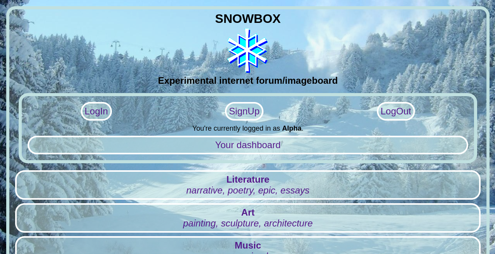
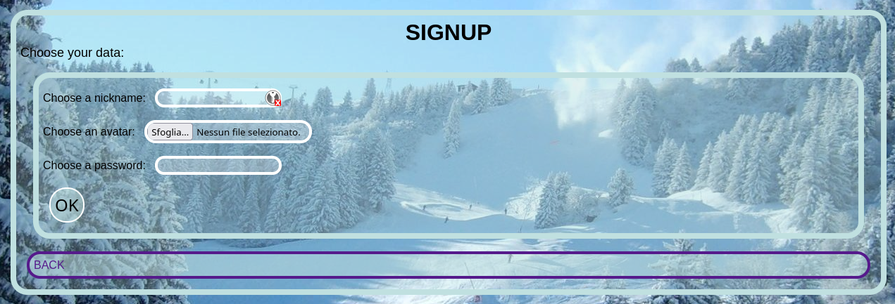
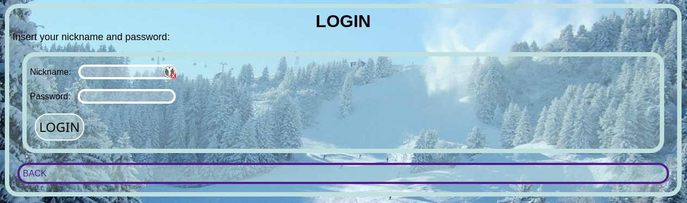
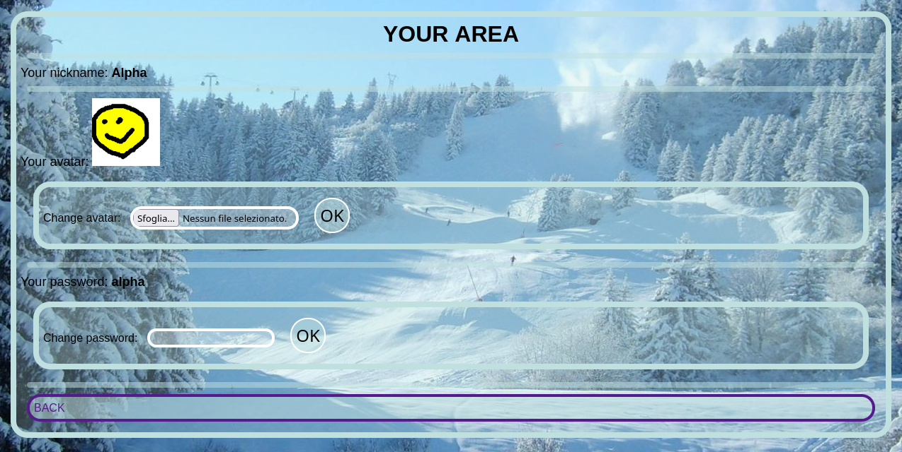
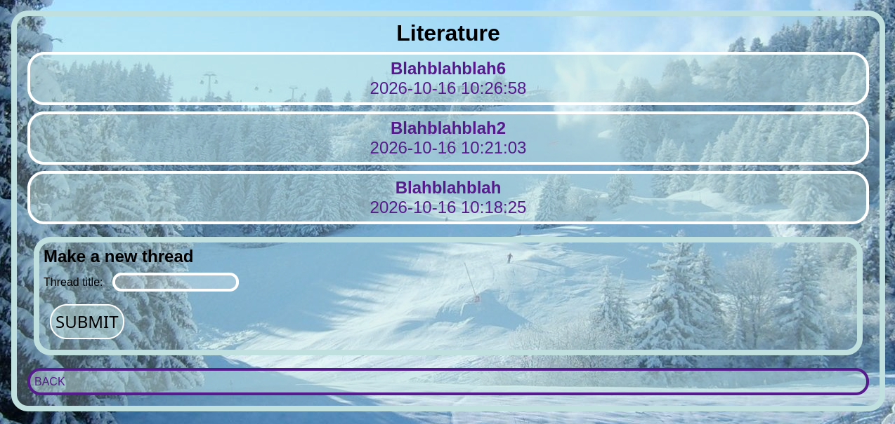
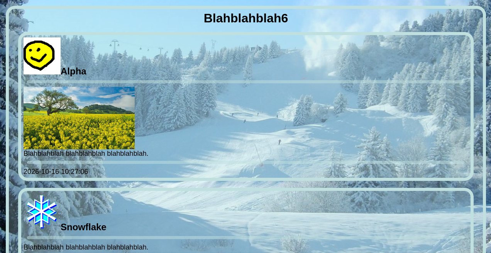

Simple internet forum/imageboard.

CURRENTLY AVAILABLE FEATURES:
- signup/login/logout
- making threads/posts
- posting pictures
- resizing pictures
- quoting other posts
- changing avatar/password
- default password hashing

STILL UNAVAILABLE FEATURES:
- changing nickname
- spoilering/un-spoilering pictures

INFORMATIONS:
- Made in nginx with PHP and SQLite.
- You can test a restricted version at this link: https://heliogeorge.heliohost.us/snowbox/index.php
- Warning: the linked test version does not implement password hashing yet.

STRUCTURE:
- .git:          Git directory (you can remove it).
- examples:      Screenshots of the site in action (you can remove it).
- pics:          This is where all pics are stored.
- database.db:   SQLite database.
- error.log:     Used during development for checking errors/bugs (you can remove it).
- index.php:     Home page.
- login.php:     Login page.
- README.md:     Informations about this project (you can remove it).
- signup.php:    Signup page.
- snowstyle.css: Looks and aesthetics.

SCREENSHOTS:
- Home Page:

- Signup form:

- Login form:

- User area:

- Board example:

- Thread example:

